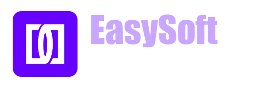

<div align="center">
<div align="center">
  
  <br><br>
  
</div>

# 🍔 FoodHub — Food Order System
### Version 1.0 | Web Application Prototype

**Developed by Evan Keal | EasySoft — Software Engineering & Development**


**🍽️ Modern Food Ordering • 💻 Full-Stack Development • 🗄️ Database Integration**

</div>

---

## 🟣 About FoodHub

**FoodHub Food Order v1.0** is a completed web application prototype developed under **EasySoft**, my personal software development brand.

The project was created as a web-based alternative to the original FoodHub desktop application developed using **C# .NET**.

Rather than designing an entirely new system from scratch, the web prototype was structured around the UML diagrams and architectural concepts of the existing desktop application.

The objective was to explore a different technology stack while preserving the fundamental concept of food ordering and database management.

The application combines **Vue.js** for frontend development, **C++** for backend programming, and **SQLite** for data storage.

> 💡 **Project Vision:** Transform an existing desktop food ordering concept into a more accessible, maintainable, and scalable web-based solution.

---

## ✨ Project Highlights

- 🍔 **Food Ordering Concept** — Web-based food ordering application prototype.
- 🌐 **Modern Web Interface** — Frontend developed using Vue.js, HTML5, and CSS3.
- ⚙️ **C++ Backend** — Backend implementation using C++ technologies.
- 🗄️ **SQLite Database** — Lightweight relational database integration.
- 📐 **UML-Based Design** — System structure inspired by the original C# .NET application.
- 🔐 **OpenSSL Integration** — OpenSSL included in the development technology stack.
- 🧩 **CMake Build System** — C++ build configuration and project management.
- 🤖 **AI-Assisted Programming** — Development supported by AI programming tools.
- 🔄 **Future Improvements** — Planned architecture and functionality enhancements.

---

## 🛠️ Technology Stack

| Category | Technologies |
|---|---|
| 🎨 Frontend | Vue.js, HTML5, CSS3 |
| ⚙️ Backend | C++ |
| 🏗️ Build System | CMake |
| 🔐 Supporting Library | OpenSSL |
| 🗄️ Database | SQLite |
| 💻 Code Editor | Visual Studio Code |
| 🌿 Version Control | Git |
| 🤖 Development Method | AI-Assisted Programming |
| 📐 System Design | UML Diagrams |

### Technology Badges


---

## 🏗️ System Architecture

The FoodHub prototype follows a web-based architecture consisting of three primary layers.

```text
                  🍔 FOODHUB v1.0
                 WEB APPLICATION
                        │
                        ▼
          ┌──────────────────────────┐
          │      FRONTEND LAYER      │
          │                          │
          │    Vue.js + HTML + CSS   │
          └────────────┬─────────────┘
                       │
                       ▼
          ┌──────────────────────────┐
          │      BACKEND LAYER       │
          │                          │
          │           C++            │
          │                          │
          │    CMake / OpenSSL       │
          └────────────┬─────────────┘
                       │
                       ▼
          ┌──────────────────────────┐
          │      DATABASE LAYER      │
          │                          │
          │          SQLite          │
          └──────────────────────────┘
```

### Architecture Overview

**Frontend:** Responsible for presenting the food ordering interface and supporting user interactions.

**Backend:** Implements application logic and coordinates communication with the database.

**Database:** Provides relational data storage for the application prototype.

**Build Environment:** CMake supports the C++ development and build process.

---

## 📐 UML-Based Development

FoodHub v1.0 was developed using UML diagrams derived from the original C# .NET FoodHub desktop application.

These diagrams provided a reference for translating the desktop system's underlying concepts into a web application.

### Development Objectives

- Preserve the original application's core concept.
- Explore a web-based implementation.
- Apply existing UML design documentation.
- Integrate frontend and backend technologies.
- Establish a foundation for future improvements.

---

## 🤖 AI-Assisted Development

The FoodHub prototype was developed using an AI-assisted programming approach.

AI tools supported the implementation process, while the project was organized and developed using **Visual Studio Code** and **Git**.

This project provided an opportunity to explore the integration of modern frontend technologies with a C++ backend and a lightweight SQL database.

---

## 🚀 Future Development Roadmap

Although FoodHub v1.0 is a completed prototype, additional development is planned.

| Priority | Planned Improvement |
|---|---|
| 🏗️ Architecture | Strengthen application structure |
| ⚙️ Backend | Improve backend organization and reliability |
| 🗄️ Database | Refine database design and operations |
| 🎨 UI/UX | Enhance usability and interface consistency |
| 🧪 Testing | Expand functionality and reliability testing |
| 🔐 Security | Review and strengthen security measures |
| 📈 Scalability | Prepare the system for future expansion |

> **Development Status:** Version 1.0 is complete as a prototype. The improvements listed above are planned and should not be interpreted as implemented features.

---

## 📊 Project Information

| Property | Details |
|---|---|
| 📌 Project Name | FoodHub Food Order |
| 🏷️ Version | 1.0 |
| ✅ Status | Completed Prototype |
| 🏢 Brand | EasySoft |
| 👨‍💻 Developer | Evan Keal |
| 🌐 Application Type | Web Application |
| 💻 Frontend | Vue.js, HTML, CSS |
| ⚙️ Backend | C++ |
| 🗄️ Database | SQLite |
| 🛠️ Development Tools | VS Code, Git |
| 🤖 Programming Approach | AI-Assisted |
| 📐 Design Reference | Original FoodHub C# .NET UML Diagrams |

---

## 👨‍💻 Developer

### Evan Keal

**Software Developer | Full-Stack Development | Game Development Enthusiast**

🏢 **Development Brand:** EasySoft  
🌍 **Country:** Sri Lanka  
💻 **GitHub:** [aimstudios3001](https://github.com/aimstudios3001)  
🌐 **Portfolio:** [Personal Portfolio](https://evan-keal-portfolio.vercel.app)

---

## 💜 EasySoft

**Software Engineering & Development**

EasySoft is my independent software development brand, focused on exploring practical software solutions, modern development technologies, and innovative application concepts.

FoodHub v1.0 represents one of the brand's experimental full-stack web development projects.

---

<div align="center">

### 🍔 FoodHub Food Order v1.0

**✅ COMPLETED — WEB APPLICATION PROTOTYPE**

*Designed to evolve. Built to improve.*

**Developed with 💜 by Evan Keal**

**© 2026 EasySoft — All Rights Reserved**

⭐ **Thank you for exploring this project!**

</div>